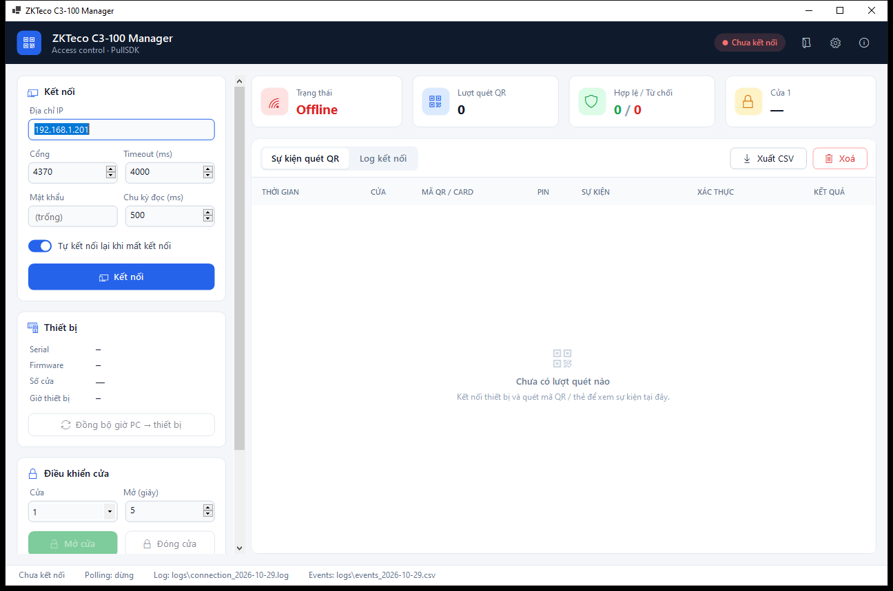

# ZKTeco C3-100 Manager

Ứng dụng Windows (WinForms, .NET 8) kết nối bộ điều khiển kiểm soát ra vào **ZKTeco C3-100** qua PullSDK, ghi lại sự kiện quét **QR / thẻ**, xác thực mã quét qua **API của bạn** (hoặc hỏi người vận hành) rồi mở cửa, và lưu log kết nối.



## Tính năng

- **Kết nối TCP/IP** tới C3-100, tự kết nối lại khi mất kết nối.
- **Theo dõi sự kiện thời gian thực** (`GetRTLog`): mỗi lượt quét QR/thẻ hiện trong bảng và được ghi vào file CSV theo ngày.
- **Verify API**: gửi mã vừa quét tới API của bạn (URL, Headers, Body tuỳ chỉnh). API trả về cho phép thì app ra lệnh mở cửa.
- **Xác thực thủ công**: chưa cấu hình API thì hiện popup hỏi người vận hành có mở cửa không, có đếm ngược và tự từ chối khi hết giờ.
- **Điều khiển cửa**: mở N giây hoặc đóng ngay.
- **Thông tin thiết bị**: serial, firmware, số cửa, giờ thiết bị; đồng bộ giờ từ PC sang thiết bị.
- **Log kết nối** có màu theo cấp độ, đồng thời ghi ra file.
- **Xem lại mã QR** của bất kỳ lượt quét nào: tạo lại ảnh QR từ nội dung, sao chép mã, lưu ảnh PNG.

## Yêu cầu

| Thành phần | Ghi chú |
|---|---|
| Windows 10/11 | Icon dùng font Segoe MDL2 Assets có sẵn trong Windows |
| .NET 8 SDK (để build) | https://dotnet.microsoft.com/download/dotnet/8.0 |
| **.NET 8 Desktop Runtime x86** (để chạy) | PullSDK thường là DLL 32-bit nên app build x86 |
| PullSDK của ZKTeco | Có sẵn trong `ZKTecoC3Manager\ZKTecoSDK\`, xem mục [Đưa DLL vào thư mục bin](#đưa-dll-vào-thư-mục-bin) |
| ZKTeco C3-100 + đầu đọc QR | Ví dụ QR500/QR600 nối vào controller qua Wiegand/RS485 |

## Cài đặt

1. **Clone repo**
   ```
   git clone <url-repo>
   cd zkteco_c3_100
   ```
2. **DLL của PullSDK** đã có sẵn trong `ZKTecoC3Manager\ZKTecoSDK\` (kèm `QRCoder.dll`). Khi build, các DLL này được tự copy ra cạnh file exe.
   > Nếu thiết bị của bạn cần bản SDK khác, thay các file `.dll` trong thư mục này bằng bộ PullSDK từ ZKTeco hoặc nhà cung cấp thiết bị.
3. **Build và chạy**
   ```
   dotnet run --project ZKTecoC3Manager
   ```
   Hoặc mở `ZKTecoC3Manager\ZKTecoC3Manager.csproj` bằng Visual Studio 2022 rồi bấm F5.

> Nếu bộ PullSDK của bạn là bản **64-bit**, đổi `<PlatformTarget>x86</PlatformTarget>` thành `x64` trong `ZKTecoC3Manager.csproj`.

## Đưa DLL vào thư mục bin

App gọi `plcommpro.dll` qua P/Invoke, nên lúc chạy **các DLL của PullSDK phải nằm cùng thư mục với `ZKTecoC3Manager.exe`**. Nếu thiếu, app báo `DllNotFoundException: plcommpro.dll` ngay khi bấm Kết nối.

### Cách 1: Tự động khi build (mặc định)

Không cần làm gì thêm. `ZKTecoC3Manager.csproj` đã cấu hình để **mỗi lần build hoặc publish**, mọi file `ZKTecoSDK\*.dll` tự được copy ra cạnh exe:

```xml
<None Include="ZKTecoSDK\*.dll"
      CopyToOutputDirectory="PreserveNewest"
      CopyToPublishDirectory="PreserveNewest"
      Link="%(Filename)%(Extension)" />
```

```
dotnet build ZKTecoC3Manager -c Release
```

DLL sẽ có trong `ZKTecoC3Manager\bin\Release\net8.0-windows\` (bản Debug nằm ở `bin\Debug\net8.0-windows\`). Build bằng Visual Studio (F5 / Ctrl+Shift+B) cũng vậy.

- Muốn thêm hoặc thay DLL: chép vào `ZKTecoSDK\` rồi build lại. Nếu bin chưa cập nhật, chạy **Rebuild** (hoặc `dotnet build --no-incremental`).
- Sau mỗi lần build, project tự kiểm tra: nếu bin không có `plcommpro.dll`, build sẽ hiện cảnh báo *"Không thấy plcommpro.dll trong ..."* để bạn biết trước khi chạy app.

### Cách 2: Chép tay vào bin

Chỉ cần khi chạy file exe build từ nơi khác, hoặc khi bin vẫn bị thiếu DLL. Mở PowerShell ở thư mục gốc repo:

```powershell
# Bản Release
Copy-Item ZKTecoC3Manager\ZKTecoSDK\*.dll ZKTecoC3Manager\bin\Release\net8.0-windows\ -Force

# Bản Debug
Copy-Item ZKTecoC3Manager\ZKTecoSDK\*.dll ZKTecoC3Manager\bin\Debug\net8.0-windows\ -Force
```

Hoặc bằng Explorer: chọn **tất cả** file `.dll` trong `ZKTecoC3Manager\ZKTecoSDK\` rồi dán vào thư mục chứa `ZKTecoC3Manager.exe`.

### Cách 3: Đóng gói để chạy trên máy khác

```
dotnet publish ZKTecoC3Manager -c Release -o publish
```

Thư mục `publish\` chứa exe kèm đủ DLL. Chép nguyên thư mục này sang máy cần chạy (máy đó cần cài **.NET 8 Desktop Runtime x86**).

### Kiểm tra

Thư mục chứa exe phải có đủ các file sau (đừng chép lẻ từng file, các DLL phụ thuộc lẫn nhau):

```
ZKTecoC3Manager.exe
QRCoder.dll
plcommpro.dll   plcomms.dll   plrscagent.dll   plrscomm.dll   pltcpcomm.dll
commpro.dll     comms.dll     rscagent.dll     rscomm.dll     tcpcomm.dll
usbcomm.dll     zkemkeeper.dll   zkemsdk.dll
```

Nếu vẫn lỗi `DllNotFoundException` dù đã đủ file, cài thêm **Visual C++ Redistributable x86**. Nếu lỗi `BadImageFormatException`, kiểm tra `PlatformTarget` (xem mục Xử lý sự cố).

## Hướng dẫn sử dụng

### 1. Kết nối thiết bị

1. Ở card **Kết nối**, nhập **Địa chỉ IP** của C3-100. Cổng mặc định là `4370`.
2. Điền **Mật khẩu** nếu controller có đặt comm key; không đặt thì để trống.
3. **Chu kỳ đọc** là khoảng thời gian giữa các lần app hỏi sự kiện mới từ thiết bị. 500 ms là hợp lý.
4. Bật **Tự kết nối lại khi mất kết nối** nếu app chạy liên tục.
5. Bấm **Kết nối** (phím tắt **F5**).
   - Thành công: pill trên header chuyển xanh "Đã kết nối", card **Thiết bị** hiện serial, firmware, số cửa, giờ thiết bị.
   - Thất bại: xem tab **Log kết nối** để biết mã lỗi (xem [Xử lý sự cố](#xử-lý-sự-cố)).
6. Nút đổi thành **Ngắt kết nối** (phím tắt **Shift+F5**).

Thông số kết nối được lưu vào `settings.json` cạnh file exe, nên lần sau mở lại không phải nhập lại.

### 2. Theo dõi sự kiện quét QR / thẻ

Tab **Sự kiện quét QR** hiện mỗi lượt quét: thời gian, cửa và hướng (vào/ra), mã QR/thẻ, PIN, sự kiện controller báo về, cách xác thực và **Kết quả**:

| Badge | Ý nghĩa |
|---|---|
| 🟢 Mở cửa | Controller cho phép, hoặc API / người vận hành đồng ý và cửa đã được mở |
| 🔴 Từ chối | Bị từ chối (hoặc hết giờ chờ, hoặc lỗi) |
| 🟠 Chờ xác thực | Đang gọi API hoặc đang chờ người vận hành trả lời |

Bốn thẻ trên cùng hiện trạng thái kết nối, tổng lượt quét, số hợp lệ / từ chối, và trạng thái cửa 1 (cần có sensor cửa).

- **Xem lại mã QR**: nhấp đúp vào một dòng (hoặc chọn dòng rồi nhấn Enter) để mở popup. Popup vẽ lại mã QR từ nội dung đã ghi và hiện chi tiết lượt quét. Trong popup có thể **Sao chép mã** (Ctrl+C) hoặc **Lưu ảnh PNG** (800 px).
- **Xuất CSV** (Ctrl+S): lưu danh sách đang hiển thị ra một file CSV.
- **Xoá**: xoá danh sách trên màn hình. File log trên đĩa vẫn giữ nguyên.

### 3. Xác thực QR / Card bằng API

Mở **Cài đặt xác thực...** (nút ở card **Xác thực QR / Card**, hoặc icon bánh răng trên header).

> **Quan trọng:** để app được quyết định mở cửa, mã QR/thẻ **không được đăng ký** trên controller. Khi đó controller báo "Thẻ chưa đăng ký", app gọi API, và nếu được phép thì gửi lệnh mở cửa. Mã đã đăng ký thì controller tự mở cửa.

| Trường | Mô tả |
|---|---|
| Bật xác thực qua API | Tắt (hoặc URL trống) thì app hỏi người vận hành bằng popup |
| URL | Ví dụ `https://api.example.com/access/verify`. Dùng được biến, ví dụ `...?code={code}` |
| Phương thức | `POST`, `PUT` hoặc `GET` |
| Headers | Mỗi dòng một header dạng `Tên: Giá trị`, ví dụ `Authorization: Bearer xxx` |
| Body data | Template nội dung gửi đi (bỏ trống nếu dùng GET) |
| Timeout (ms) | Quá thời gian này thì coi là API lỗi |
| Trường kết quả JSON | Mặc định `allow`; hỗ trợ trường lồng như `data.allow` |
| Khi API lỗi | Hỏi người vận hành (popup), hoặc Từ chối luôn |
| Bỏ qua lượt quét controller đã cho phép | Không gọi API cho mã đã đăng ký trên thiết bị |
| Mở cửa (giây) | Thời gian mở khoá khi được phép |
| Bỏ quét trùng (giây) | Bỏ qua cùng một mã quét lặp lại trong khoảng này |
| Popup tự đóng (giây) | Hết thời gian thì tự từ chối |

**Biến dùng được** trong URL, Headers và Body:

| Biến | Ví dụ |
|---|---|
| `{code}` | `QR-8F21A0C4` (nội dung mã QR / số thẻ) |
| `{pin}` | `0` |
| `{door}` | `1` |
| `{direction}` | `in` / `out` |
| `{eventType}` | `27` |
| `{eventName}` | `Thẻ chưa đăng ký` |
| `{time}` | `2026-10-29T09:14:31` |
| `{deviceSerial}` | `AJYS201760123` |

Trong URL, giá trị được mã hoá cho URL (URL-encode). Trong body JSON, giá trị được escape theo JSON.

**Body mẫu:**
```json
{
  "code": "{code}",
  "pin": "{pin}",
  "door": {door},
  "direction": "{direction}",
  "eventType": {eventType},
  "time": "{time}",
  "deviceSerial": "{deviceSerial}"
}
```

**API cần trả về** HTTP 2xx kèm JSON:
```json
{ "allow": true, "message": "Khách hẹn 09:30", "openSeconds": 5 }
```
- `allow` (bắt buộc): `true`/`false` (cũng chấp nhận `1`/`0`, `"true"`/`"false"`).
- `message` (tuỳ chọn): được ghi vào cột Xác thực và vào log.
- `openSeconds` (tuỳ chọn): số giây mở cửa, ghi đè giá trị trong cài đặt.

Bấm **Kiểm tra API** để gửi thử một mã mẫu (`TEST-QR-0001`) và xem phản hồi trước khi lưu.

### 4. Xác thực thủ công (popup)

Khi chưa cấu hình API, mỗi lượt quét bị controller từ chối sẽ hiện popup **"Mở cửa cho lượt quét này?"** kèm mã, cửa, PIN, thời gian và lý do:

- **Mở cửa** (Enter): gửi lệnh mở cửa.
- **Không mở** (Esc): từ chối.
- Không trả lời trước khi hết giờ đếm ngược thì tự **từ chối**.
- Nhiều lượt quét cùng lúc thì popup lần lượt hiện từng cái. Lượt nào chờ quá lâu thì bị huỷ.

### 5. Điều khiển cửa và thiết bị

- **Mở cửa**: mở khoá cửa đã chọn trong số giây đã nhập (1–254).
- **Đóng cửa**: khoá cửa ngay.
- **Đồng bộ giờ PC → thiết bị**: chỉnh giờ controller theo giờ máy tính.

## File log

Nằm trong thư mục `logs\` cạnh file exe (icon thư mục trên header mở nhanh thư mục này):

| File | Nội dung |
|---|---|
| `connection_yyyy-MM-dd.log` | Log kết nối, lỗi SDK, kết quả gọi API, dữ liệu RTLog thô (mức DEBUG) |
| `events_yyyy-MM-dd.csv` | Mỗi lượt quét một dòng: thời gian, cửa, mã, PIN, sự kiện, xác thực, kết quả |

## Xử lý sự cố

| Lỗi | Cách xử lý |
|---|---|
| `DllNotFoundException: plcommpro.dll` | Thư mục chứa exe thiếu DLL. Rebuild, hoặc chép tay theo mục [Đưa DLL vào thư mục bin](#đưa-dll-vào-thư-mục-bin). Một số bản SDK cần thêm Visual C++ Redistributable x86 |
| `BadImageFormatException` / "Sai kiến trúc DLL" | DLL 32-bit mà app chạy 64-bit, hoặc ngược lại. Sửa `PlatformTarget` cho khớp |
| Không chạy được app x86 | Cài **.NET 8 Desktop Runtime x86** |
| Connect lỗi `-307` | Sai IP/cổng, hoặc PC không cùng mạng với controller |
| Connect lỗi `-12` | Sai mật khẩu kết nối (comm key) |
| Connect lỗi `-2` | Timeout: thiết bị không phản hồi, thử tăng Timeout |
| Visual Studio dừng ở exception khi debug | App đã bắt lỗi và ghi vào Log kết nối. Bấm Continue, hoặc chạy bằng Ctrl+F5 |

## Cấu trúc mã nguồn

```
ZKTecoC3Manager/
├─ Sdk/PullSdk.cs              Khai báo các hàm của plcommpro.dll để gọi từ C#
├─ Services/
│  ├─ C3Controller.cs          Kết nối, polling GetRTLog, tự kết nối lại, điều khiển cửa
│  ├─ RtLogParser.cs           Phân tích dữ liệu RTLog, tên sự kiện
│  ├─ VerifyApiClient.cs       Gọi Verify API theo template URL / Headers / Body
│  ├─ AppLogger.cs             Log kết nối ra file + UI
│  ├─ EventCsvWriter.cs        Ghi / xuất CSV sự kiện
│  └─ AppSettings.cs           Lưu settings.json
├─ Forms/                      Hộp thoại cài đặt xác thực, popup mở cửa
├─ UI/                         Theme và các control tự vẽ (card, nút, tab...)
├─ MainForm.cs                 Logic màn hình chính
├─ MainForm.Layout.cs          Dựng giao diện bằng code (không dùng Designer)
└─ ZKTecoSDK/                  DLL PullSDK (và QRCoder.dll)
```

> Giao diện được dựng bằng code. Hãy mở các form bằng **View Code (F7)**, đừng mở bằng Designer.

## Lưu ý bảo mật

- `settings.json` lưu Headers dạng chữ thường, không mã hoá (có thể chứa token API). File này đã có trong `.gitignore`, không được đẩy lên repo.
- File log và CSV có mã thẻ/QR của người dùng. Hãy bảo quản theo quy định nội bộ.
